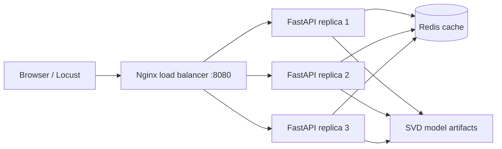

# Movie Recommendation Service

A movie recommendation API built on the MovieLens dataset: collaborative filtering evaluated on held-out ratings, served by multiple FastAPI replicas behind an Nginx load balancer with a shared Redis cache, load-tested with Locust, tested with pytest in CI, and paired with a small React front end.

## Architecture



## Results

### Model quality

Precision@10 and Recall@10 on each user's most recent 20% of ratings (MovieLens ml-latest-small, 100,836 ratings from 610 users; a liked movie means rating 4.0 or higher). From `results/model_results.md`.

| Model | Precision@10 | Recall@10 | Users evaluated |
|---|---|---|---|
| Popularity baseline | 0.0611 | 0.0493 | 592 |
| SVD collaborative filtering (16 factors) | 0.0860 | 0.0834 | 592 |

### Serving performance

Locust with no wait between requests (`constant(0)`), 200 users, spawn rate 50/s, 60 seconds, 4 Locust processes, through Nginx, everything on one 10-core laptop. From `results/load_results.md`.

| Scenario | Requests/s | Median (ms) | 95th percentile (ms) | Requests | Failures |
|---|---|---|---|---|---|
| A: 1 replica, no cache | 2530.6 | 75 | 99 | 151896 | 0 |
| B: 3 replicas + Redis cache | 3701.8 | 3 | 170 | 222179 | 0 |

- **Throughput:** 3 replicas with Redis served 46% more requests per second than 1 replica without cache. Nginx split the load evenly (about 74,000 requests per replica), and 99.6% of Redis lookups were hits.
- **Why not 3x:** each replica is one single-process Uvicorn server, and all replicas, Nginx, and the four Locust processes share the same laptop CPUs. During Scenario B, each replica used roughly one full core and Nginx about half a core, so the machine itself limits how much extra replicas can add.
- **Latency:** with no wait time, each user sends its next request as soon as the last one returns, so average latency is roughly users divided by throughput (200 / 3,700 ≈ 54 ms in B). The median dropped from 75 ms to 3 ms because most cached requests return immediately, but the 95th percentile rose from 99 ms to 170 ms. Scenario B's latencies are split into two groups: about two thirds finish within 31 ms and most of the rest take 150 to 180 ms. Where those slower requests wait has not been isolated yet.

## Quickstart

Prerequisites: Python 3.10 or newer, and Docker Desktop for the scaled setup.

```bash
# 1. Set up Python
python -m venv .venv
source .venv/bin/activate            # Windows: .venv\Scripts\activate
pip install -r requirements.txt

# 2. Download MovieLens (about 1 MB)
python data/download_movielens.py

# 3. Train, evaluate, and save the model (writes artifacts/ and results/model_results.md)
python -m recommender.train

# 4. Run the tests
pytest -q

# 5. Optional: run the API alone, without Docker (open http://localhost:8000/docs)
uvicorn api.main:app --reload
```

### Run the scaled setup (3 replicas + Redis + Nginx)

```bash
docker compose up --build -d
```

- Front end: http://localhost:8080
- Health check: http://localhost:8080/api/health. Refresh a few times and `served_by` changes as Nginx rotates through replicas.

### Load test: before and after scaling

```bash
# Scenario A: 1 replica, no cache
docker compose down
CACHE_ENABLED=false docker compose up --build -d --wait --scale api=1
locust -f loadtest/locustfile.py --host http://localhost:8080 --users 200 --spawn-rate 50 --run-time 60s --headless --processes 4 --csv results/scenario_a

# Scenario B: 3 replicas with Redis cache
docker compose down
docker compose up --build -d --wait
locust -f loadtest/locustfile.py --host http://localhost:8080 --users 200 --spawn-rate 50 --run-time 60s --headless --processes 4 --csv results/scenario_b

# Compare (writes results/load_results.md)
python loadtest/summarize.py
docker compose down
```

Report whatever the numbers show, even if the difference is small. On a single laptop, all replicas share the same CPU, so gains from extra replicas can be modest; caching usually helps more. `--processes 4` needs Locust 2.x on macOS or Linux (it forks); on Windows, drop it.

## How it works

- **Time-based split:** for each user, the most recent 20% of ratings form the test set, so the model is always judged on what users rated next.
- **Models:** a popularity baseline, and truncated SVD on the user-movie rating matrix. The number of factors is chosen on a validation split taken only from the training period. The served model is then retrained on all ratings.
- **Metrics:** Precision@10 and Recall@10, counting a movie as relevant if the user rated it 4.0 or higher.
- **Serving:** FastAPI loads plain NumPy arrays, caches responses in Redis with a 5-minute expiry, and reports which replica answered.
- **Cold start:** unknown users get popular movies they haven't seen.

## Project structure

```
recommender/   data loading, time split, models, evaluation, training script
api/           FastAPI service with optional Redis cache
tests/         pytest tests on synthetic data (no download needed)
loadtest/      Locust load test and results summary
nginx/         load balancer config
frontend/      React front end (no build step)
data/          download script; the dataset itself is not committed
```

## Data

MovieLens ml-latest-small, by GroupLens Research (https://grouplens.org/datasets/movielens/). See the dataset's README for its license and citation terms.
